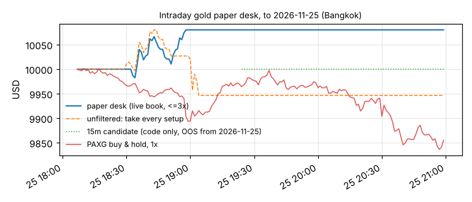

# Intraday gold paper desk, 2026-11-25 (Bangkok; period 2026-11-24 21:00 to 2026-11-25 21:00)

PAPER ONLY. PAXG/USDT 1m bars from Binance public data. Decisions fill at the next 1m open.

- Live book: **10,080.23 USD** (+0.80% since start); PAXG buy & hold 1x: 9,855.30 (-1.45%)
- Last 24 h (21:00-21:00): +0.80%; halted today: no
- Unfiltered book (takes every setup, no AI): **9,946.58 USD** (-0.53%); AI filter adds +1.34% of capital; unfiltered last 24 h: 3 trades, 1 wins, -53.42 USD
- 15m candidate book (code only, 0 tokens; true out-of-sample since 2026-11-25): **10,000.00 USD** (+0.00%)
- Shadow books (AI desk decisions at 1x/10x/30x): 1x 10,027, 10x 10,267, 30x 10,802

## Trades

| In | Out | Side | Oz | Entry | Exit | Exit reason | P&L USD |
|---|---|---|---|---|---|---|---|
| 18:33 | 18:58 | SELL | 8.54 | 3512.37 | 3502.98 | target | +80.23 |

## AI desk vs take-every-setup vs 15m candidate

Expectancy = average P&L per trade in USD after costs. Profit factor = gross wins / gross losses.

| Book, period | Trades | Win rate | Avg win | Avg loss | Expectancy | Profit factor |
|---|---|---|---|---|---|---|
| AI desk, last 24 h | 1 | 100% | +80.23 | +0.00 | **+80.23** | inf |
| AI desk, since start | 1 | 100% | +80.23 | +0.00 | **+80.23** | inf |
| take every setup, last 24 h | 3 | 33% | +80.19 | -66.80 | **-17.81** | 0.60 |
| take every setup, since start | 3 | 33% | +80.19 | -66.80 | **-17.81** | 0.60 |
| 15m candidate, last 24 h | 0 | - | - | - | - | - |
| 15m candidate, since start | 0 | - | - | - | - | - |

Opus stated probabilities (for calibration): none in the last 24 h

## Model calls and tokens

| Model | Calls | Tokens |
|---|---|---|
| haiku | 3 | 199,213 |
| sonnet | 1 | 65,919 |
| total | 4 | 265,132 |

Skipped or rejected setups: 2
- 18:45 20261125-1845-breakout: position already open
- 20:35 20261125-2035-breakout: calendar: USD High 'Core PCE Price Index m/m' at 13:30 UTC ±30 min
