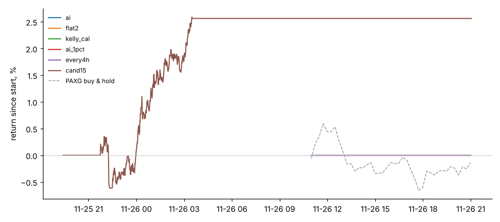

# Swing desk report (PAPER), 2026-11-26 21:00 Bangkok

PAXG/USDT, paper only. ai = one Opus call per 4h wake, code re-checks every rule; risk linear in Opus p (0.55 1%, 0.65 2%, >=0.75 3%), halts -5%/-8%, kill -15%; flat2 = same decisions at flat 2%; kelly_cal = eighth Kelly on calibrated p (0.5-3%, skip if f <= 0); ai_1pct = the same decisions at 1% risk, halts -3%/-6%, kill -10%; every4h = code takes every 4h Donchian-20 signal (unfiltered baseline, 3x cap); cand15 = 15m candidate (code, intraday rules).

## Since start
| Book | Trades | Win | Avg win / loss USD | Exp USD | Exp R | PF | Equity | Return |
|---|---|---|---|---|---|---|---|---|
| ai | 0 | - | - | - | - | - | 10,080.23 | +0.00% |
| flat2 | 0 | - | - | - | - | - | 10,080.23 | +0.00% |
| kelly_cal | 0 | - | - | - | - | - | 10,080.23 | +0.00% |
| ai_1pct | 0 | - | - | - | - | - | 10,080.23 | +0.00% |
| every4h | 0 | - | - | - | - | - | 10,080.23 | +0.00% |
| cand15 | 2 | 50% | +317.63 / -61.29 | +128.17 | - | 5.18 | 10,256.34 | +2.56% |

## Period 11-25 21:00 -> 11-26 21:00
| Book | Trades | Win | Avg win / loss USD | Exp USD | Exp R | PF | Equity | Return |
|---|---|---|---|---|---|---|---|---|
| ai | 0 | - | - | - | - | - | 10,080.23 | +0.00% |
| flat2 | 0 | - | - | - | - | - | 10,080.23 | +0.00% |
| kelly_cal | 0 | - | - | - | - | - | 10,080.23 | +0.00% |
| ai_1pct | 0 | - | - | - | - | - | 10,080.23 | +0.00% |
| every4h | 0 | - | - | - | - | - | 10,080.23 | +0.00% |
| cand15 | 2 | 50% | +317.63 / -61.29 | +128.17 | - | 5.18 | 10,256.34 | +2.56% |

PAXG buy and hold since the AI book started: -0.14%. Shadow books (same AI decisions, fixed notional): 1x 10,080.23, 3x 10,080.23, 10x 10,080.23, 30x 10,080.23.

## The owner's real 70 USD account, mirroring the AI trades (code only)
| Book | Trades | Wins | Trading | Locked | Total | Return | Max drawdown | Blown up / stopped out |
|---|---|---|---|---|---|---|---|---|
| real70_paxg | 0 | 0 | 70.00 | 0.00 | 70.00 | +0.0% | 0.0% | no |
| real70_xau_minlot | 0 | 0 | 70.00 | 0.00 | 70.00 | +0.0% | 0.0% | no |
| aggr30 | 0 | 0 | 70.00 | 0.00 | 70.00 | +0.0% | 0.0% | no |
| real70_follow_2100 | 0 | 0 | 70.00 | 0.00 | 70.00 | +0.0% | 0.0% | no |

aggr30 weekly return vs the +30%/week target: week of 2026-11-23: +0.0% (target +30%)
Withdrawal policy (real70_paxg, real70_follow_2100, aggr30; at the 21:02 run, from cash only): milestones once each (2x start -> the 70 USD stake; 10k / 100k / 1M THB -> 30% / 40% / 50%; 1M USD -> 70%), then 25% of gains above the high-water mark. Locked money never trades again. Rate fixed at 34.0 THB/USD.
aggr30: 20% risk per trade, max 10x, main-book costs, stop-out at 50% margin level, dead stays dead. PAXG spot: 2% risk, max 1x, 0.10% fee per side. XAU CFD: always 1 oz (0.01 lot), 0.30/oz spread per side, 1:100 margin, stop-out at 50% margin level; a stop of S USD loses about S USD, i.e. S/70 of the account.

## News desk (separate PAPER book, 10,000 USD start, 1% risk; live equity 10000.00; sim = replay with a simulated actual)
| Event | Mode | Playbook | Actual (latency) | Decision | Trades | P&L | First fill | Opus tokens | Venice calls |
|---|---|---|---|---|---|---|---|---|---|
| 20261125-2030 | sim_combined_real | Core PCE drives gold here; GDP is secondary. Trend is down on 4h and 1 | Core 0.3 (official BEA (code) 5.0s; official 5.0s, headline 240.0s); Prelim 4.3 (official BEA (code) 5.0s; official 5.0s, headline Nones) | None | - | +0.00 | None s | 67255 | 1 |
| 20261125-2030 | sim_hot | Core PCE drives gold. Hot print: sell with the 4h/1h downtrend. Cool p | Core 0.4 (headline+venice 45.0s; official Nones, headline Nones) | hot_core_pce | S 3488.38->3506.88 stop | -88.10 | 60.0 s | 66128 | 1 |
| 20261125-2030 | sim_noactual | Core PCE drives gold. Hot print: sell with the 4h/1h downtrend. Cool p | none | reaction_drop | S 3498.49->3477.99 target | +107.89 | 120.0 s | 66128 | 0 |
| 20261125-2030 | sim_official_real | Core PCE drives gold. Hot print: sell with the 4h/1h downtrend. Cool p | Core 0.3 (official BEA (code) 5.0s; official 5.0s, headline 240.0s); Prelim 4.3 (official BEA (code) 5.0s; official 5.0s, headline Nones) | inline_core_pce | - | +0.00 | None s | 66128 | 1 |
| 20261125-2030-whatif | sim_whatif | WHAT-IF only: the same playbook with sell_threshold 0.5 instead of 0.7 | Core 0.3 (official BEA (code) 5.0s; official 5.0s, headline Nones); Prelim 4.3 (official BEA (code) 5.0s; official 5.0s, headline Nones) | combined sell | S 3488.38->3506.88 stop | -88.10 | 60.0 s | 67255 | 0 |
Fallback usage (live events): 0/0 (decided without the actual number). Venice parser: nvidia-nemotron-3-nano-30b-a3b (benchmark 2026-11-26 06:49 UTC, median 0.52 s)

## US stocks side study (paper)
US stocks (paper research, 72 variants, OOS 2023-2026): no ETF rule family beats buy-and-hold SPY/QQQ out of sample after costs.
Best chosen OOS: trend QQQ > SMA150 band 2% else cash Sharpe 1.03 vs SPY 1.20; full table trading/us/REPORT.md.

## Shocks and statements
Shocks (unscheduled moves; code blocked entries 30 min, tightened wrong-side stops): 0 in the period, 0 since start.
Statements now: Tally (confidence >= 0.6): 9 bullish, 3 bearish, 2 neutral.

## AI decisions
Opus calls 3, tokens 209,428 (period: 3 calls, 209,428 tokens). Skipped wakes (no call, flat and entries blocked): 0.
| Time | Action | p | Lev | Result |
|---|---|---|---|---|
| 11-26 11:11 | hold | None | None | HOLD |
| 11-26 15:11 | hold | None | None | HOLD |
| 11-26 19:11 | hold | None | None | HOLD |

## Calibration (p_target vs target hit before stop; ideas = best_idea of every answer, scored on 1m bars, never traded)
| p bucket | n | mean p | hit rate |
|---|---|---|---|
| 0.00-0.40 | 0 | - | - |
| 0.40-0.50 | 0 | - | - |
| 0.50-0.55 | 0 | - | - |
| 0.55-0.65 | 0 | - | - |
| 0.65-1.00 | 0 | - | - |

Halts / kill: AI None, None, killed None.

