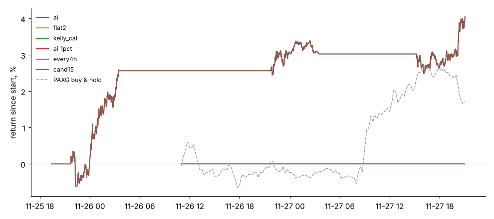

# Swing desk report (PAPER), 2026-11-27 21:00 Bangkok

PAXG/USDT, paper only. ai = one Opus call per 4h wake, code re-checks every rule; risk linear in Opus p (0.55 1%, 0.65 2%, >=0.75 3%), halts -5%/-8%, kill -15%; flat2 = same decisions at flat 2%; kelly_cal = eighth Kelly on calibrated p (0.5-3%, skip if f <= 0); ai_1pct = the same decisions at 1% risk, halts -3%/-6%, kill -10%; every4h = code takes every 4h Donchian-20 signal (unfiltered baseline, 3x cap); cand15 = 15m candidate (code, intraday rules).

## Since start
| Book | Trades | Win | Avg win / loss USD | Exp USD | Exp R | PF | Equity | Return |
|---|---|---|---|---|---|---|---|---|
| ai | 0 | - | - | - | - | - | 10,080.23 | +0.00% |
| flat2 | 0 | - | - | - | - | - | 10,080.23 | +0.00% |
| kelly_cal | 0 | - | - | - | - | - | 10,080.23 | +0.00% |
| ai_1pct | 0 | - | - | - | - | - | 10,080.23 | +0.00% |
| every4h | 0 | - | - | - | - | - | 10,080.23 | +0.00% |
| cand15 | 3 | 67% | +181.89 / -61.29 | +100.83 | - | 5.94 | 10,402.68 | +4.03% |

## Period 11-26 21:00 -> 11-27 21:00
| Book | Trades | Win | Avg win / loss USD | Exp USD | Exp R | PF | Equity | Return |
|---|---|---|---|---|---|---|---|---|
| ai | 0 | - | - | - | - | - | 10,080.23 | +0.00% |
| flat2 | 0 | - | - | - | - | - | 10,080.23 | +0.00% |
| kelly_cal | 0 | - | - | - | - | - | 10,080.23 | +0.00% |
| ai_1pct | 0 | - | - | - | - | - | 10,080.23 | +0.00% |
| every4h | 0 | - | - | - | - | - | 10,080.23 | +0.00% |
| cand15 | 1 | 100% | +46.15 / +0.00 | +46.15 | - | inf | 10,402.68 | +1.43% |

PAXG buy and hold since the AI book started: +1.72%. Shadow books (same AI decisions, fixed notional): 1x 10,080.23, 3x 10,080.23, 10x 10,080.23, 30x 10,080.23.

## The owner's real 70 USD account, mirroring the AI trades (code only)
| Book | Trades | Wins | Trading | Locked | Total | Return | Max drawdown | Blown up / stopped out |
|---|---|---|---|---|---|---|---|---|
| real70_paxg | 0 | 0 | 70.00 | 0.00 | 70.00 | +0.0% | 0.0% | no |
| real70_xau_minlot | 0 | 0 | 70.00 | 0.00 | 70.00 | +0.0% | 0.0% | no |
| aggr30 | 0 | 0 | 70.00 | 0.00 | 70.00 | +0.0% | 0.0% | no |
| real70_follow_2100 | 0 | 0 | 70.00 | 0.00 | 70.00 | +0.0% | 0.0% | no |

aggr30 weekly return vs the +30%/week target: week of 2026-11-23: +0.0% (target +30%)
Withdrawal policy (real70_paxg, real70_follow_2100, aggr30; at the 21:02 run, from cash only): milestones once each (2x start -> the 70 USD stake; 10k / 100k / 1M THB -> 30% / 40% / 50%; 1M USD -> 70%), then 25% of gains above the high-water mark. Locked money never trades again. Rate fixed at 34.0 THB/USD.
aggr30: 20% risk per trade, max 10x, main-book costs, stop-out at 50% margin level, dead stays dead. PAXG spot: 2% risk, max 1x, 0.10% fee per side. XAU CFD: always 1 oz (0.01 lot), 0.30/oz spread per side, 1:100 margin, stop-out at 50% margin level; a stop of S USD loses about S USD, i.e. S/70 of the account.

## News desk (separate PAPER book, 10,000 USD start, 1% risk; live equity 10000.00; sim = replay with a simulated actual)
| Event | Mode | Playbook | Actual (latency) | Decision | Trades | P&L | First fill | Opus tokens | Venice calls |
|---|---|---|---|---|---|---|---|---|---|
| 20261125-2030 | sim_combined_real | Core PCE drives gold here; GDP is secondary. Trend is down on 4h and 1 | Core 0.3 (official BEA (code) 5.0s; official 5.0s, headline 240.0s); Prelim 4.3 (official BEA (code) 5.0s; official 5.0s, headline Nones) | None | - | +0.00 | None s | 67255 | 1 |
| 20261125-2030 | sim_hot | Core PCE drives gold. Hot print: sell with the 4h/1h downtrend. Cool p | Core 0.4 (headline+venice 45.0s; official Nones, headline Nones) | hot_core_pce | S 3488.38->3506.88 stop | -88.10 | 60.0 s | 66128 | 1 |
| 20261125-2030 | sim_noactual | Core PCE drives gold. Hot print: sell with the 4h/1h downtrend. Cool p | none | reaction_drop | S 3498.49->3477.99 target | +107.89 | 120.0 s | 66128 | 0 |
| 20261125-2030 | sim_official_real | Core PCE drives gold. Hot print: sell with the 4h/1h downtrend. Cool p | Core 0.3 (official BEA (code) 5.0s; official 5.0s, headline 240.0s); Prelim 4.3 (official BEA (code) 5.0s; official 5.0s, headline Nones) | inline_core_pce | - | +0.00 | None s | 66128 | 1 |
| 20261125-2030-whatif | sim_whatif | WHAT-IF only: the same playbook with sell_threshold 0.5 instead of 0.7 | Core 0.3 (official BEA (code) 5.0s; official 5.0s, headline Nones); Prelim 4.3 (official BEA (code) 5.0s; official 5.0s, headline Nones) | combined sell | S 3488.38->3506.88 stop | -88.10 | 60.0 s | 67255 | 0 |
Fallback usage (live events): 0/0 (decided without the actual number). Venice parser: nvidia-nemotron-3-nano-30b-a3b (benchmark 2026-11-26 06:49 UTC, median 0.52 s)

## The fund (long-term US stocks)
Fund: monthly DCA 10,000 THB (LOW 20% SGOV, MEDIUM 70% = SPYM 96% + ADBE 4%, HIGH 10% gold reserve in SGOV); orders.md has the Dec lines in THB and USD.
First buy Mon 30 Nov or Tue 1 Dec; shadow book (DCA, money-weighted vs SPY) starts with the Dec deposit.
Fund shadow (DCA 10,000 THB/month): not started; first deposit on the first trading day of Dec 2026 (no price yet).

## cand15: flat by 03:30 (A) vs hold overnight (B; live since 2026-11-27)
cand15 clock rules (Feb-Nov 2026, 1m replay, 10k start): A flat 03:30 +1,117 (DD -15.3%); B hold overnight/flat before weekend +2,639 (DD -18.4%); C no clock rules +2,478 (DD -17.5%); D keep only >=0.5R trend-agreeing +1,352 (DD -13.9%; corrected 2026-11-27, a time-unit bug had let D see future 1h data), typical MT5 swap -0.60/oz.
Pre-agreed rule (best net P&L, DD <= 1.25x A, >= 30 trades) picks B with the typical swap; with the boss figure (-6/oz, about 10x typical) B and C fail the DD cap and A stays. Applied and confirmed by the boss: the live cand15 paper book runs B from 2026-11-27 (swap -0.60/+0.20 per oz until the owner sends the real MT5 values; then re-test and revert if B fails).
AI desk weekend/event rule: not testable yet, the AI journal has 0 trades (all HOLD); left unchanged. Caveat: one 9-month trending sample; the extra-hours gain rests on a few big nights.
cand15 by month (reports/cand15_regime.md): losses in Mar-May (-1,733) and Sep (-293), gains in Feb, Jun-Aug, Oct-Nov; across 10 months avg R correlates only weakly with gold's monthly return (+0.20) or volatility (-0.22). Pre-registered regime switches: the in-sample pick (vol_high) fails out of sample (lead -0.08R, band [-0.36, +0.20]); trend_down looks better out of sample (+0.31R vs +0.19R) but picking it now would be hindsight, so it is pre-registered for a forward test only. cand15 stays always on.
Running extra-hours P&L (live cand15, rule B since 2026-11-27): +0.00 USD over 0 trades held past 03:30 (0 gained); swap paid +0.00.

## Learning (Opus calibration loop)
Learning: 8 Opus best ideas resolved: stated p 0.40, realised target-first 0.00, avg R -1.00; calibration rule now: bucket >0.55: (0 x 0.00 + 10 x base 0.17) / (0 + 10) -> p 0.60 counts as 0.17.
Gate and sizing use p_cal; at today's numbers an entry needs p_cal >= 0.55, so the desk stays flat until Opus's ideas start hitting.

## Confidence tests (is there a 'trade only when confident' edge?)
Confidence test 1 (Opus calibration, resolver fixed to read the live cache): 6 of 7 live best_ideas resolved, ALL hit their stops (stated p 0.35-0.42, realised 0/6, -1R each); with the earlier replay (stated 0.40 vs realised 0.25) Opus is clearly overconfident. The desk now gates and sizes on calibrated p (6 ideas: a stated 0.60 counts as 0.19).
Test 2 (cand15 selectivity, 10 pre-registered filters, fit Feb-Jul, judged Aug-Nov): the in-sample pick (session 20-24 Bangkok) trails all trades out of sample (avg R +0.14 vs +0.17, band [-0.30, +0.24]); no subset passes.
Verdict: no high-confidence subset exists in this data; keep trading all cand15 signals at fixed risk (all trades: OOS win 42%, avg R +0.17, Kelly +0.14, about 44 trades/month), and re-run the calibration when 30+ Opus ideas have resolved. Note: cand15 was flat in-sample (avg R -0.01) and positive only Aug-Nov.

## US stocks side study (paper)
US stocks (paper research, 72 variants, OOS 2023-2026): no ETF rule family beats buy-and-hold SPY/QQQ out of sample after costs.
Best chosen OOS: trend QQQ > SMA150 band 2% else cash Sharpe 1.03 vs SPY 1.20; full table trading/us/REPORT.md.

## Shocks and statements
Shocks (unscheduled moves; code blocked entries 30 min, tightened wrong-side stops): 2 in the period, 2 since start.
- 2026-11-27 09:00 up +12.8 USD/5m (5.2x ATR1m), entries blocked 30 min: no headlines
- 2026-11-27 09:34 up +15.2 USD/5m (5.1x ATR1m), entries blocked 30 min: ‘We want to stop killing’: Trump defends ties with Putin, sa [bearish]; SCHOTT Achieves EcoVadis Gold - Ink World Magazine [neutral]
Statements now: Tally (confidence >= 0.6): 6 bullish, 2 bearish, 0 neutral.

## AI decisions
Opus calls 9, tokens 631,551 (period: 6 calls, 422,123 tokens). Skipped wakes (no call, flat and entries blocked): 0.
| Time | Action | p | Lev | Result |
|---|---|---|---|---|
| 11-26 11:11 | hold | None | None | HOLD |
| 11-26 15:11 | hold | None | None | HOLD |
| 11-26 19:11 | hold | None | None | HOLD |
| 11-26 23:11 | hold | None | None | HOLD |
| 11-27 03:11 | hold | None | None | HOLD |
| 11-27 07:11 | hold | None | None | HOLD |
| 11-27 11:17 | hold | None | None | HOLD |
| 11-27 15:10 | hold | 0.0 | 1 | HOLD |
| 11-27 19:11 | hold | None | None | HOLD |

## Calibration (p_target vs target hit before stop; ideas = best_idea of every answer, scored on 1m bars, never traded)
| p bucket | n | mean p | hit rate |
|---|---|---|---|
| 0.00-0.40 | 1 | 0.35 | 0.00 |
| 0.40-0.50 | 7 | 0.41 | 0.00 |
| 0.50-0.55 | 0 | - | - |
| 0.55-0.65 | 0 | - | - |
| 0.65-1.00 | 0 | - | - |

Halts / kill: AI None, None, killed None.

